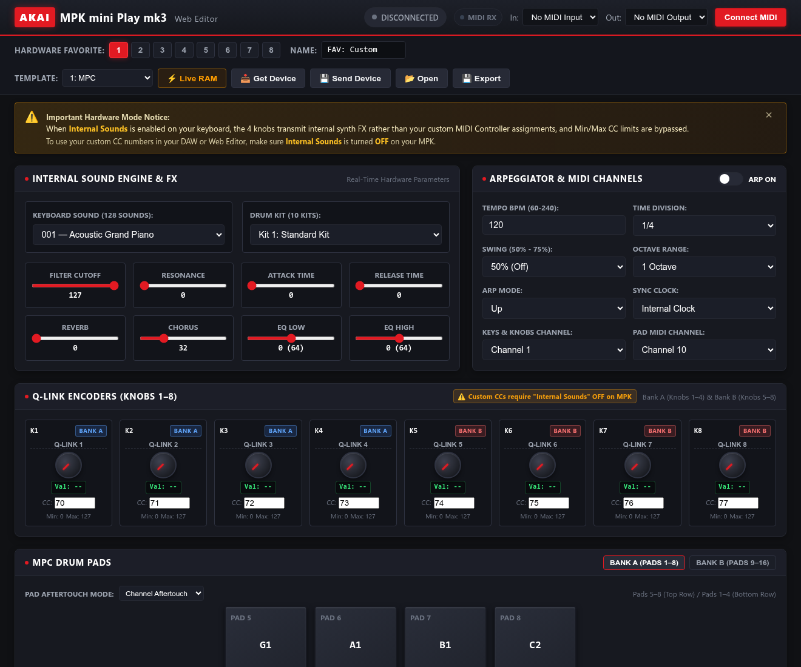

# Akai MPK Mini Play mk3 — Web Favorite Editor

<p align="center">
  <a href="https://sebos69.github.io/mpk-mini-play-editor/">
    
  </a>
</p>

<p align="center">
  <a href="https://sebos69.github.io/mpk-mini-play-editor/"><strong>⚡ https://sebos69.github.io/mpk-mini-play-editor/ ⚡</strong></a>
  <br>
  <em>Zero installation required • Runs directly in your browser on Linux, macOS, Windows, and ChromeOS</em>
</p>

<p align="center">
  <a href="https://www.w3.org/TR/webmidi/"></a>
  <a href="https://developer.mozilla.org/en-US/docs/Web/JavaScript"></a>
  <a href="#architecture--tech-stack"></a>
  <a href="https://pages.github.com/"></a>
  <a href="LICENSE"></a>
</p>

An open-source, pure client-side web application to configure and edit the **Akai Professional MPK mini Play mk3** portable synthesizer and USB MIDI keyboard directly in your web browser.

<p align="center">
  <a href="https://sebos69.github.io/mpk-mini-play-editor/" title="Click to launch the live web editor">
    
  </a>
</p>

---

## 🌐 Live Web Application

> [!TIP]
> ### 🎛️ **[Click here to open the Web Editor: https://sebos69.github.io/mpk-mini-play-editor/](https://sebos69.github.io/mpk-mini-play-editor/)**
> 
> Simply plug in your Akai MPK Mini Play mk3 via USB, open the URL in **Google Chrome**, **Microsoft Edge**, **Brave**, or **Opera**, and click **Connect MIDI**. Works directly on **Linux, macOS, Windows, and ChromeOS** with zero drivers or installation required.

---

## 🎹 Why This Project?

The **Akai MPK Mini Play mk3** is a hybrid controller: it combines a 25-key USB MIDI controller with an internal sound engine (Dream S.A.S. SAM2635 synthesizer DSP with 128 acoustic/synth instruments and 10 drum kits) and a built-in speaker.

However, the official Akai Preset Editor:
- Is a closed-source Windows/macOS desktop application.
- Does not run on **Linux** or **ChromeOS**.
- Requires running installer executables and separate audio drivers.
- Lacks real-time interactive parameter auditioning and live MIDI stream visualization.

This project was built from the ground up by reverse-engineering the USB SysEx protocol and desktop binary format, providing a modern, high-performance, and platform-agnostic web alternative.

---

## ✨ Key Features

### 🎛️ Full Hardware Parameter Editing
- **Internal Sounds & FX**: Edit the 128 keyboard sound programs, 10 drum kits, low-pass filter cutoff, resonance, attack time, release time, reverb send, stereo chorus depth, and 2-band EQ (Low / High).
- **16 MPC Drum Pads**: Accurate physical 4x2 geometry for Bank A (Pads 1–8) and Bank B (Pads 9–16), customizable MIDI notes, dedicated pad MIDI channel, and selectable Channel or Polyphonic Aftertouch.
- **8 Rotary Q-Link Knobs**: 60+ FPS real-time hardware tracking, custom CC assignments, minimum/maximum ranges, parameter names, and interactive on-screen rotary dragging with mouse wheel and fine-tuning support.
- **4-Way Analog Joystick**: Configure X and Y axes independently for 14-bit Pitch Bend, Single CC (Modulation Wheel), or Dual CC with automatic spring-loaded center release physics.
- **Hardware Arpeggiator**: Control Tempo (60–240 BPM), Time Division (1/4 to 1/32T), Swing (50%–75%), Octave Range (1–4), Playback Modes (Up, Down, Excl, Incl, Order, Rand), Latch, and Internal/External MIDI Clock.
- **Keybed Velocity Sensitivity Calibration**: Visual interactive SVG Bezier curve editor for the 4 hardware velocity thresholds (`p1`, `p2`, `p3`, `p4`) and Black Key Velocity Balance (Opcode `0x13`).

### ⚡ Automated SysEx Memory Management
- **One-Click Read from Hardware**: Read active configurations directly from the physical keyboard via SysEx (`0x66`).
- **Automated Dual-Write Flash & RAM Sync**: When sending presets, the editor automatically writes to persistent EEPROM (Favorite 1–8) and immediately updates the active sound engine in volatile RAM (Slot 8)—**with zero physical button presses required**.
- **Send to RAM (Live Audition)**: Test sounds and tweaks live through the keyboard's internal speaker without overwriting saved flash memory.
- **Official Factory Presets**: Built-in 1-click loading for all 8 official Akai factory presets.

### 📊 Real-Time MIDI Stream & Hex Monitor
- **Stutter-Free 60 FPS Event Logging**: Real-time monitoring for Note On/Off, CC, Pitch Bend, Aftertouch, Clock, and SysEx.
- **Synchronized Visual Feedback**: On-screen pads flash and piano keys depress in real time when played on the physical keyboard.
- **Raw SysEx Hex Console**: Inspect exact transmitted and received byte sequences.
- **Local Sound Audition Preview**: Integrated Web Audio piano and drum synthesizers to preview sounds in your browser when not listening through the keyboard's speaker.

### 💾 Desktop Preset Compatibility
- **Import & Export `.mpkminiplaymk3`**: Full two-way compatibility with preset files saved by the official Akai desktop editor.

---

## 🚀 Quick Start Guide

### 1. Requirements
- An **Akai MPK mini Play mk3** connected via a standard USB cable.
- A Chromium-based browser supporting the Web MIDI API:
  - **Google Chrome** (v43+)
  - **Microsoft Edge** (v79+)
  - **Brave Browser**
  - **Opera**

### 2. Getting Connected
1. Open the application (either hosted on GitHub Pages or locally via a local server).
2. Click the **Connect MIDI** button in the top navigation bar.
3. When prompted by your browser, grant **MIDI and System Exclusive permissions**.
4. The status pill will change to `Connected: MPK mini Play mk3`.
5. Click **Get Device** to pull your current hardware preset into the editor.

> [!WARNING]
> ### ⚠️ Crucial Mode Notice: "Internal Sounds" vs. "MIDI Controller" Mode
> On the physical keyboard, whether the **`INTERNAL SOUNDS`** button is ON or OFF drastically changes the MIDI data transmitted over USB:
> - **When `INTERNAL SOUNDS` is OFF ("MIDI Controller Mode")**: The 4 rotary knobs transmit your custom programmed CC numbers (e.g., CC 70–77) and adhere to your configured Min/Max value ranges. **This is the mode you should use with DAWs and custom MIDI mappings.**
> - **When `INTERNAL SOUNDS` is ON ("Internal Sounds Mode")**: The 4 knobs control internal sound engine FX (Cutoff, Resonance, Reverb, Chorus, Attack, Release, EQ Low, EQ High). When turned, they send internal synth FX parameters instead of your custom CC numbers, and Min/Max limits are ignored.
> 
> If the knobs in your DAW or MIDI monitor appear to send unexpected CC numbers or ignore Min/Max limits, verify that **`INTERNAL SOUNDS` is toggled OFF on your MPK**.

---

## 🛠️ Deploying to GitHub Pages

You can host your own copy of the web editor for free in less than a minute using GitHub Pages:

1. **Clone or Fork** this repository:
   ```bash
   git clone https://github.com/sebos69/mpk-mini-play-editor.git
   cd mpk-mini-play-editor
   ```
2. In your GitHub repository, navigate to **Settings** → **Pages**.
3. Under **Build and deployment**:
   - **Source**: You can choose either:
     - **Deploy from a branch** (Branch: `main`, Folder: `/ (root)`): The included root `index.html` will automatically forward visitors directly to the `./web/` application.
     - **GitHub Actions**: The included workflow ([`.github/workflows/deploy.yml`](.github/workflows/deploy.yml)) will deploy the `./web` app directly.
4. Open the site in Google Chrome, Microsoft Edge, Brave, or Opera and start editing!

> [!NOTE]
> Because Web MIDI API requires a **Secure Context** (`HTTPS`), hosting on GitHub Pages works out of the box with zero SSL configuration required.

### Running Locally
To test or develop locally without an internet connection:
```bash
# Using Python 3's built-in web server:
python3 -m http.server 8000 --directory web

# Or using Node.js:
npx serve web
```
Navigate to `http://localhost:8000` in your browser.

---

## 🔬 Reverse-Engineered Hardware Protocol

Comprehensive documentation for developers, hackers, and synth enthusiasts is available in [**`PROTOCOL.md`**](PROTOCOL.md).

### Quick Protocol Highlights:
- **Akai Manufacturer ID**: `0x47`
- **Device ID**: `0x7F` (Host Broadcast) / `0x00` (Hardware Reply)
- **Model Code**: `0x50` (`AD21` / MPK Mini Play mk3)
- **Opcode `0x66`**: Request Preset (`F0 47 7F 50 66 00 01 <slot> F7`)
- **Opcode `0x67`**: Hardware Preset Response (`F0 47 00 50 67 01 58 <slot> <215 bytes payload> F7`)
- **Opcode `0x64`**: Write Preset (`F0 47 7F 50 64 01 58 <target> <215 bytes payload> F7`)
  - Target `0x00`–`0x07`: Writes to Flash EEPROM (Favorites 1–8).
  - Target `0x08`: Writes to volatile RAM (Immediate sound engine activation).
- **Opcode `0x13`**: Keybed Velocity Sensitivity Curve Calibration.

### Internal Sounds Mode Behavior:
The keyboard houses an ARM microcontroller linked via internal UART to a **Dream S.A.S. SAM2635 synthesizer DSP**. The physical `INTERNAL SOUNDS` button acts as a **local hardware audio gate** and speaker amplifier mute. It does not transmit any MIDI or SysEx messages across the USB interface. To prevent sound collisions when connected to a computer, the web editor includes a persistent **Sound Audition Preview** toggle to easily mute browser audio.

---

## 📁 Repository Structure

```text
├── .github/
│   └── workflows/
│       └── deploy.yml          # GitHub Pages automated deployment workflow
├── web/                        # Pure static Web MIDI application
│   ├── index.html              # Main single-page web application
│   ├── css/
│   │   └── app.css             # High-performance CSS styles & dark theme
│   └── js/
│       ├── app.js              # Application controller & 60 FPS rAF render loop
│       ├── midi.js             # Web MIDI API manager & Web Audio synth engine
│       ├── protocol.js         # Binary & SysEx encoder / decoder codecs
│       └── factory-presets.js  # Base64-encoded official Akai factory presets
├── docs/                       # Project documentation & media
│   └── screenshots/            # High-resolution UI captures
├── PROTOCOL.md                 # Complete reverse-engineered protocol documentation
├── README.md                   # Project documentation & release guide
└── LICENSE                     # MIT License
```

---

## 💻 Tech Stack & Architecture

- **Pure Vanilla ES2022 JavaScript** with ES Modules.
- **Zero External Dependencies**: No React, no Vue, no Webpack, no npm packages, no CDN links.
- **Hardware-Accelerated 60+ FPS Rendering**: Custom `requestAnimationFrame` batching pipeline with $O(1)$ pre-cached DOM nodes, completely preventing forced synchronous layout reflows during high-speed MIDI streams.
- **Web Audio API**: Real-time sound synthesis for standalone auditioning.
- **Web MIDI API**: Standard-compliant SysEx bidirectional communication.

---

## 🤝 Contributing

Contributions, feature requests, and bug reports are welcome!
1. Fork the Project.
2. Create your Feature Branch (`git checkout -b feature/AmazingFeature`).
3. Commit your Changes (`git commit -m 'Add AmazingFeature'`).
4. Push to the Branch (`git push origin feature/AmazingFeature`).
5. Open a Pull Request.

---

## 📜 License & Disclaimers

Distributed under the **MIT License**. See `LICENSE` for more information.

*Disclaimer: This project is an independent open-source tool and is not affiliated with, sponsored by, or endorsed by Akai Professional or inMusic Brands, Inc. "Akai", "MPK mini Play", and other product names are registered trademarks of inMusic Brands, Inc.*

